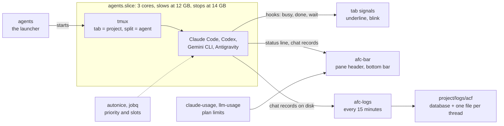

# Agentic CLI Fleet (ACF)

One terminal window that runs many coding agents at once, each in its own tab or split, on one Linux machine. Claude Code, Codex, Gemini CLI and Antigravity sit side by side; the fleet keeps them inside a memory and CPU budget, shows what each one is doing, and keeps a log of every conversation.

This folder is **where the fleet lives**. Its programs and its tmux config run from here: the usual home-folder paths (`~/.local/bin/agents`, `~/.local/bin/afc-*`, `~/.tmux.conf`, …) are links to the files in this folder, so an edit here is live at once (programs on their next call, the tmux config after Ctrl+B then R).

Three things stay as real files in the home folder, with a copy kept here: the resource guard (`autonice`, `jobq`, `keepawake-agents`), the systemd units, and the machine's own lists (accounts, projects, prices). They must keep working when this drive is not mounted, and the lists hold real account names. `bash _tools/collect.sh` refreshes those copies.

Moved here: 2026-11-16, on the Kubuntu 24.04 workstation.

**If this drive is not mounted or this folder is moved**, the links break and the fleet will not start. The last home-folder copies are in `~/.local/share/acf-home-backup-20261116/` with restore steps in its `README.txt`; after a move, `bash _tools/install.sh --apply` from the new place re-points the links.

## What it does

| Capability | What you get |
|---|---|
| **Many agents, one window** | One tab per project and any number of splits inside it. Each split runs Claude Code, Codex, Gemini CLI, Antigravity or a plain terminal, started fresh, in plan mode (read-only for Codex) or with no permission prompts. |
| **Picks up where you stopped** | `agents` reopens every project on its list and continues each one's last chat. A folder whose chat is already open in another window gets a note instead of a second agent. |
| **Several accounts per tool** | Alt+G moves the agent in a pane to another account (Claude keeps the same chat) or to another tool. A new split starts on the account of the pane it came from. A label can stand in for an account name on a shared screen. |
| **Shows what every agent is doing** | A tab's name is underlined while an agent in it works, and the tab blinks when one has finished or is waiting for an answer. Each pane's header shows tool, account, model, effort, tokens, share of the model's window, cost and plan limits. |
| **A window manager for splits** | Move, merge, minimise, maximise and close with a key or a click on the pane header. A thin scrollbar through the chat, copy longer than one screen, paste of text or an image. |
| **A resource budget** | Every agent and everything it starts runs in one capped group: 3 CPU cores, slowed at 12 GB of memory, stopped at 14 GB. Builds, tests and agents get lower priority. At most 2 heavy jobs and 3 dev servers run at once; the rest wait their turn. The machine stays awake while agents work. |
| **A permanent chat log** | Every 15 minutes each tool's chat records are copied into the project they belong to: a searchable database and one readable file per thread, with secrets replaced by `[redacted]`. No model is asked, so it costs no tokens. |
| **Plan limits and cost at a glance** | Session and weekly limits per account for Claude, Codex and Antigravity, and what each conversation would cost at list prices. |
| **Rebuilds from this folder** | `install.sh` sets a machine up; `build-tmux.sh` builds the patched tmux with no download and no sudo. |

## What you see

```
── [C / acct] [C5.5-Opu X] [T:265k 26% $22.24] [S0% W4%] ───────────── [↔ – □ ✕]     pane header
   ... the agent ...                                                          ▎          scrollbar
 ACF | 1 ProjectA | 2 ProjectB            [C:27%|R:47%|F:5 1.5G/12G]  ▣ 1  ◀  ▶        bottom bar
```

**Pane header**, one per split:

| Field | Meaning |
|---|---|
| `[C / acct]` | which tool (C Claude, X Codex, G Gemini, A Antigravity) and which account |
| `[C5.5-Opu X]` | model and effort: maker letter, version, 3 letters of the name, effort (L M H X) |
| `[T:265k 26% $22.24]` | tokens the chat holds, share of the model's window, cost (`~$` = estimated from list prices) |
| `[S0% W4%]` | plan limits used: 5-hour session, week (plus a per-model cap when that model is in use) |
| `[↔ – □ ✕]` | move, minimise, maximise, close: for that split |

**Bottom bar**: tabs, then machine CPU and RAM and the fleet's agent count and memory against its cap, `▣ N` when N splits are minimised, and previous / next tab.

## Keys

| Key | Does |
|---|---|
| Alt+1 … Alt+0 | jump to tab 1 … 10 |
| Alt+\ / Alt+- | split right / below, with a menu of what to start there |
| Alt+G | change the agent or account in this pane |
| Alt+M | pick the model or effort (Claude, Gemini) without the agent's own tall picker |
| Alt+J | move this split: left, right, up, down, merge under a neighbour, own column |
| Alt+H / Alt+U | minimise this split / bring a minimised one back |
| Alt+Z | maximise this split to the whole tab, and back |
| Alt+Q | close this split (asks first) |
| Alt+S / Alt+X | show another tab beside this one / send this pane to its own tab |
| Alt+N / Alt+C | add a project folder as a new tab / plain terminal tab |
| Ctrl+V | paste text or an image |
| Ctrl+click, scroll, Ctrl+click | copy a stretch longer than one screen |
| Ctrl+B then R | reload the config |

Everything with a button also lights up under the pointer and can be clicked, menus included.

## Commands

| Command | Does |
|---|---|
| `agents` | open the fleet, or attach to it if it is running |
| `agents --add [folder] [name]` | add a project (default: this folder); opens its tab if the fleet is up |
| `agents --status` | list the tabs and the fleet's memory |
| `agents --dry-run` | show what would open, start nothing |
| `agents --accounts` | list every tool's accounts and who is signed in to each |
| `agents --usage` | plan limits per Claude account |
| `agents --as <account>` | run Claude on that account in any terminal (`gemini:<account>`, `codex:<account>`, `agy:<account>` for the others) |
| `agents --kill` | stop every agent (asks first) |
| `afc-logs search WORDS` | search this project's chat log (`--all` for every project) |
| `afc-logs threads`, `afc-logs show THREAD` | list the threads, print one |
| `jobq <command>` | run a heavy command when a slot is free, instead of being paused |
| `jobq --status`, `autonice --status` | who holds the slots, what is throttled |

## How it works



**Starting the fleet** (`agents`, or the Agents entry in the desktop menu)

1. `agents` reads the project list, `~/.config/agents/projects`: one `<tab name> <folder>` per line.
2. It starts the tmux server inside `agents.slice`, so everything started from a tab falls under the budget.
3. Each project gets a tab. A folder with an earlier chat continues it, on the account that chat belongs to; otherwise a new chat starts.
4. The window attaches. If the fleet is already running, `agents` attaches to it; a second window gets its own view of the same agents.

**While an agent works**

1. Hooks in each tool's settings call `agents --mark`: `busy` when a prompt is sent or a tool runs, `done` when the turn ends, `wait` when it asks for permission, `end` when it closes.
2. `--mark` sets a flag on the pane and tmux draws it: the tab's name is underlined while any agent in it is busy, and the tab blinks when one finishes or waits while you are looking elsewhere. Looking at the tab clears the blink.
3. A turn that ends with a background command still running stays underlined until that command ends.

**The pane header** (redrawn about once a second)

1. Claude hands its status-line data to `afc-statusline`, which saves model, effort, limits, tokens and cost for that pane.
2. `afc-bar` works out which tool and account the pane runs from the pane's own processes, reads that saved line, and adds the plan limits from `claude-usage` or `llm-usage`. Both answer from a cache and refresh it in the background, so the bar never waits.
3. Codex, Gemini and Antigravity have no status line: `afc-agent-info` reads the same facts from the chat records they keep on disk.

**Changing the account or tool in a pane** (Alt+G)

1. The menu lists every account of every tool, with who is signed in.
2. Another Claude account: the pane restarts on that account and resumes the same chat. All Claude accounts share one chat store through links; only the sign-in differs. The move is remembered, so a restart reopens that chat on that account.
3. Another tool: that agent starts in the same folder with a fresh chat.

**The resource guard** (`autonice`, every 5 seconds)

1. Processes that match `~/.config/autonice/rules` get a lower CPU and disk priority and are moved into the capped group. Priority is only ever lowered.
2. A background job that matches a `gate` rule takes a slot. With no slot free it is paused, and resumed when one frees. `jobq <command>` waits for a slot instead.
3. If `autonice` stops, it first resumes everything it paused.

**The chat log** (`afc-logs`, every 15 minutes)

1. The run is skipped when CPU or RAM is at 85% or more.
2. It finds the chat files that changed, for all four tools, and reads what is new.
3. Each thread goes to the project it ran in: the fleet project, else the nearest folder above with a `.git`, `CLAUDE.md`, `AGENTS.md` or `_ai`, else the folder itself. Chats run in the home folder or a temp folder go to `~/logs/acf/`.
4. Secrets are replaced by `[redacted]`, then the entries go into `logs/acf/acf.db` (full-text search) and one `.md` file per thread. In a git project, `logs/acf/` is added to `.gitignore`.

## What is in this folder

"Home path" is where the machine looks for it. **link** = the home path points at this folder's file (this is the live one); **copy** = the live one is a real file at home and this is its copy.

| Path | Home path | What it is |
|---|---|---|
| `bin/agents` | link: `~/.local/bin/agents` (also as `afc`) | the launcher: opens the fleet, tabs, splits, account and split menus |
| `bin/afc-bar` | link: `~/.local/bin/` (so are all `bin/afc-*` and the two usage tools) | draws the pane header and the bottom bar's figures |
| `bin/afc-statusline` | | Claude's status-line hook: records model, effort, limits, tokens, cost per pane |
| `bin/afc-agent-info` | | the same facts for Codex, Gemini and Antigravity, read from their own chat records |
| `bin/claude-usage`, `bin/llm-usage` | | plan limits per account |
| `bin/afc-logs` | | the chat log: every thread copied into `<project>/logs/acf/`, searchable, no tokens |
| `bin/afc-min`, `bin/afc-move` | | minimise / restore, and move / merge splits |
| `bin/afc-reflow`, `bin/afc-gap` | | make Claude redraw after a resize, and close the gap its pop-ups leave |
| `bin/afc-longcopy`, `bin/afc-model-menu` | | long copy, and the Alt+M menu |
| `bin/autonice`, `bin/jobq`, `bin/keepawake-agents` | copy: `~/.local/bin/` | the resource guard: renices, caps and queues heavy jobs; keeps the machine awake while agents work |
| `lib/afc/pb.py` | link: `~/.local/lib/afc/` | reads Antigravity's binary records |
| `tmux/tmux.conf` | link: `~/.tmux.conf` | all keys, bars, hooks and the scrollbar |
| `tmux/afc-tmux-3.8.patch` | copy: `~/.local/opt/tmux-3.8/` | the changes to tmux 3.8 the fleet needs (below) |
| `tmux/src/`, `tmux/deps/`, `tmux/SHA256SUMS` | | the tmux 3.8 source, the build packages, and their checksums: what `build-tmux.sh` builds from |
| `config/agents/` | copy: `~/.config/agents/` | account lists per tool, project list, price table, labels |
| `config/systemd/user/` | copy: `~/.config/systemd/user/` | `agents.slice` (the budget), `autonice`, the chat-log timer |
| `config/autonice/rules` | copy: `~/.config/autonice/` | which programs get throttled or queued |
| `config/alacritty/` | copy: `~/.config/alacritty/` | the terminal the fleet window runs in |
| `config/claude/`, `config/gemini/` | | only the fleet's keys from those tools' settings, to merge by hand |
| `share/` | link: `~/.local/share/` | the desktop launcher, the window-raise script, the no-browser stand-ins |
| `_tools/` | | `collect.sh`, `install.sh`, `build-tmux.sh` |
| `logs/acf/` | | this folder's own chat log, written by `afc-logs` when an agent works here (raw transcripts: they name the real account) |

Not here, on purpose: sign-ins, other projects' chats and logs, and the built tmux program (it is rebuilt from `tmux/` and stays on the home disk, so tmux itself starts even without this drive).

## The tmux build

The fleet runs tmux 3.8 with five small patches (`tmux/afc-tmux-3.8.patch`), installed in `~/.local/opt/tmux-3.8` with `~/.local/bin/tmux` pointing at it. Stock tmux will run the config but loses these:

| Patch | Gives |
|---|---|
| `screen-redraw.c`, `window-copy.c` | a thin scrollbar slider (`@scrollbar-slider`) that stops short of the pane's bottom (`@scrollbar-bottom-margin`) |
| `format.c` | the column and row of a click on a pane border, so the header buttons can be told apart |
| `key-string.c`, `server-client.c` | mouse hover: `@mouse-hover on`, and bindable `MouseMoveStatus` / `MouseMoveBorder` / `MouseMovePane` |

To build it, everything needed is in this folder: the official source (`tmux/src/tmux-3.8.tar.gz`), the patch, and the four build packages (`tmux/deps/`, Ubuntu 24.04 amd64; unpacked to a temporary folder, never installed). No download and no sudo:

```bash
bash _tools/build-tmux.sh --dry-run
```

```bash
bash _tools/build-tmux.sh
```

It takes about a minute, installs into `~/.local/opt/tmux-3.8`, and keeps the previous program beside the new one. Add `--prefix <folder>` to try a build without touching the installed one. A running fleet only picks up a new build after a restart.

To change tmux itself: unpack the source, apply the patch, edit, then write the new differences back to `tmux/afc-tmux-3.8.patch` (same `orig/tmux-3.8/…` and `src/tmux-3.8/…` path style, applied with `patch -p2`) and run the build script.

## Things that will bite

- **Claude runs in classic mode** (`"tui": "default"`): that is what lets tmux keep the chat history for the scrollbar. The price is that Claude does not re-wrap on its own; `afc-reflow` and `afc-gap` press Ctrl+L for it.
- **A chat belongs to an account.** A restart reopens each chat on the account that owns it, and a new split takes the account of the pane it came from. Resuming a chat on another organisation's account makes Claude drop its earlier thinking.
- **A fleet restart stops every agent.** Chats resume; the step in progress, extra splits, minimised splits and jobs in terminal splits do not.
- **Start the fleet from the desktop**, not from inside an agent's shell: that shell's environment would leak into every agent.
- **Claude deletes its own chat files after 30 days.** `afc-logs` is the permanent copy.

## Stand-in names

One account name on the machine is not allowed in this workspace's documents. In the copied lists under `config/` it reads `acct1` (account lists, folder paths, a commented line); a few comments in `bin/` say `acct1` too, which changes nothing in how they run. The real name and the pairing live only on the machine, in `~/.config/agents/copy-names`. `collect.sh` swaps the name out of `config/` on the way in and `install.sh` swaps it back on the way out, so the live fleet is never renamed. On a machine without that map, `install.sh` installs the stand-in as the account's name. The chat log in `logs/acf/` is a raw record and is not swapped.

## Changing the fleet

- A program in `bin/`, `lib/` or `share/`, or `tmux/tmux.conf`: edit it here. It is the live file.
- A machine list, a systemd unit or the resource guard: edit the real file in the home folder, then bring the copy here up to date:

```bash
bash _tools/collect.sh --dry-run
```

```bash
bash _tools/collect.sh
```

To set a machine up to run the fleet from this folder (dry run unless `--apply` is given; links by default, `--apply --copy` for real copies):

```bash
bash _tools/install.sh
```
