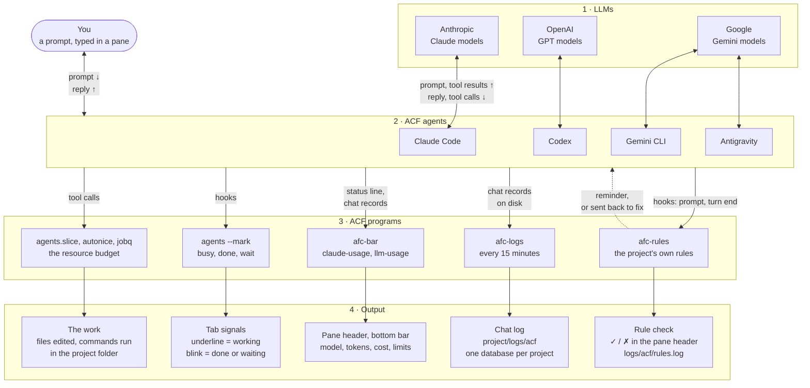

# Agentic CLI Fleet (ACF)

One terminal window that runs many coding agents at once, each in its own tab or split, on one machine: a Linux desktop, a headless Ubuntu server over SSH, a Mac, or Windows ([what each one gets](#on-other-machines)). Claude Code, Codex, Gemini CLI and Antigravity sit side by side; the fleet keeps them inside a memory and CPU budget, shows what each one is doing, and keeps a log of every conversation.

This folder is **where the fleet lives**. Its programs and its tmux config run from here: the usual home-folder paths (`~/.local/bin/agents`, `~/.local/bin/afc-*`, `~/.tmux.conf`, …) are links to the files in this folder, so an edit here is live at once (programs on their next call, the tmux config after Ctrl+B then R).

Three things stay as real files in the home folder, with a copy kept here: the resource guard (`autonice`, `jobq`, `keepawake-agents`), the systemd units, and the machine's own lists (accounts, projects, prices). They must keep working when this drive is not mounted, and the lists hold real account names. `bash _tools/collect.sh` refreshes those copies.

Moved here: 2026-11-16, on the Kubuntu 24.04 workstation.

**If this drive is not mounted or this folder is moved**, the links break and the fleet will not start. The last home-folder copies are in `~/.local/share/acf-home-backup-20261116/` with restore steps in its `README.txt`; after a move, `bash _tools/install.sh --apply` from the new place re-points the links.

## What it does

| Capability | What you get |
|---|---|
| **Many agents, one window** | One tab per project and any number of splits inside it. Each split runs Claude Code, Codex, Gemini CLI, Antigravity or a plain terminal, started fresh, in plan mode (read-only for Codex) or with no permission prompts. A new project tab starts Claude, or, with `start-agent ask` in `~/.config/agents/settings`, asks which of them to start. Each keeps a checklist of its steps while it works, as in the Claude app: the fleet switches Claude Code's task list on in every pane (`tmux/tmux.conf`), and the other three have theirs on already. Claude runs in focus view (`viewMode: focus` in the fleet's Claude keys): the commands it runs fold into one line, which Ctrl+O opens, and the checklist stays under its working line. |
| **Picks up where you stopped** | After a restart `agents` reopens every tab and every split as it was: each agent on its own account and chat, the same sizes, minimised splits still minimised. A chat that is already open in another window gets a note instead of a second agent. |
| **Several accounts per tool** | Alt+G moves the agent in a pane to another account (Claude keeps the same chat) or to another tool. A new split starts on the account of the pane it came from. The Alt+G list shows what each Claude account has used of its plan limits and which has the most room, and a warning comes when a pane's account passes 90%. An agent moved to another tool can be handed the chat so far. A label can stand in for an account name on a shared screen. |
| **Shows what every agent is doing** | A tab's name is underlined while an agent in it works, and the tab blinks when one has finished or is waiting for an answer. When you are not looking at that tab, a desktop notification says so, and a click on it brings the tab up. Alt+L lists every agent in the fleet with what it is doing. Each pane's header shows tool, account, model, effort, tokens, share of the model's window, cost and plan limits. |
| **A window manager for splits** | Move, merge, minimise, maximise and close with a key or a click on the pane header. A thin scrollbar through the chat, copy longer than one screen, paste of text or an image. |
| **A folder of its own for a split** | A split can start in its own git worktree, on its own branch. Two agents in one project then no longer write over each other's files; one agent's work comes back with an ordinary `git merge`. |
| **A resource budget** | Every agent and everything it starts runs in one capped group: 3 CPU cores, slowed at 12 GB of memory, stopped at 14 GB. Near that limit the fleet refuses to start another agent, rather than slow down the ones already running. Builds, tests and agents get lower priority. At most 2 heavy jobs and 3 dev servers run at once; the rest wait their turn. The machine stays awake while agents work. |
| **A permanent chat log** | Every 15 minutes each tool's chat records are copied into the project they belong to, as one file: a searchable database, with secrets replaced by `[redacted]`. No model is asked, so it costs no tokens. |
| **Plan limits and cost at a glance** | Session and weekly limits per account for Claude, Codex and Antigravity, and what each conversation would cost at list prices. |
| **Rebuilds from this folder** | `install.sh` sets a machine up; `build-tmux.sh` builds the patched tmux with no download and no sudo; `build-deb.sh` makes the installer, a `.deb` for an Ubuntu desktop. `agents --doctor` checks that everything is in place; `test-fleet.sh` tries the launcher on a throw-away fleet. |

## What you see

```
── [C / acct] [C5.5-Opu X] [T:265k 26% $22.24] [S0% W4%] ───────────── [↔ – □ ✕]     pane header
   ... the agent ...                                                          ▎          scrollbar
 ACF | 1 ProjectA | 2 ProjectB            [C:27%|R:47%|F:5 1.5G/12G]  ▣ 1  ◀  ▶        bottom bar
```

**Pane header**, one per split:

| Field | Meaning |
|---|---|
| `[C / acct]` | which tool (C Claude, X Codex, G Gemini, A Antigravity) and which account |
| `[C5.5-Opu X]` | model and effort: maker letter, version, 3 letters of the name, effort (L M H X) |
| `[T:265k 26% $22.24]` | tokens the chat holds, share of the model's window, cost (`~$` = estimated from list prices) |
| `[S0% W4%]` | plan limits used: 5-hour session, week (plus a per-model cap when that model is in use) |
| `[↔ – □ ✕]` | move, minimise, maximise, close: for that split |

**Bottom bar**: tabs, then machine CPU and RAM and the fleet's agent count and memory against its cap, `▣ N` when N splits are minimised, and previous / next tab.

## Keys

| Key | Does |
|---|---|
| Alt+1 … Alt+0 | jump to tab 1 … 10 |
| Alt+\ / Alt+- | split right / below, with a menu of what to start there |
| Alt+G | change the agent or account in this pane |
| Alt+M | pick the model or effort (Claude, Gemini) without the agent's own tall picker |
| Alt+L | list every agent in the fleet with what it is doing; pick one to go to it |
| Alt+K | the council: a tab with a group chat of every signed-in LLM and the agents you make, on the topic you raise, dealt into an even grid (one pane per member, each with its own scroll and a spinner while it thinks; you type in the strip at the bottom, which shows no answers). Each pane's header shows the model and effort that member runs on; Alt+M (or m) in its pane changes them. Answers are short and direct (at most 60 words; `/length N`). Tag `@name`; `/mode order`: everyone answers at once, then round the table one by one (`/rounds N`, 0 = none); `/mode roast`: all at once, then roasting each other round after round until Ctrl+C (`/rounds N` to cap it); `/mode` alone switches modes. Footers an agent's project adds (SITREP, You:, greetings) are taken off |
| Alt+J | move this split: left, right, up, down, merge under a neighbour, own column |
| Alt+H / Alt+U | minimise this split / bring a minimised one back |
| Alt+E | this project's tab on or off the express lane: first call on the fleet's CPU and its memory kept when the fleet is busy, the fleet's total unchanged (⚡ in the header; `agents --express`) |
| Alt+Z | maximise this split to the whole tab, and back |
| Alt+Q | close this split (asks first, in a pop-up in the centre: close it, minimise it instead, or keep it) |
| Alt+S / Alt+X | show another tab beside this one / send this pane to its own tab |
| Alt+N / Alt+C | add a project folder as a new tab / plain terminal tab |
| Ctrl+V | paste text or an image |
| Ctrl+click, scroll, Ctrl+click | copy a stretch longer than one screen |
| Ctrl+B then R | reload the config |

Everything with a button also lights up under the pointer and can be clicked, menus included.

## Commands

| Command | Does |
|---|---|
| `agents` | open the fleet, or attach to it if it is running; a start reopens the saved tabs and splits |
| `agents --fresh` | start with one pane per project instead of the saved splits |
| `agents --layout` | show the saved tabs and splits: what the next start reopens |
| `agents --overview` | every agent in one list: tab, working / waiting / done, tokens, cost, limits |
| `agents --express [project]` | list the express lane, or put a project's tab on it / take it off (the same as Alt+E); kept in `~/.config/agents/express`, applied again when the tab is opened, restored or split |
| `agents --worktrees` | the work folders made for splits; `--prune` removes the finished ones |
| `agents --doctor` | check that links, hooks, services and the watcher are in place; changes nothing |
| `agents --add [folder] [name]` | add a project (default: this folder); opens its tab if the fleet is up |
| `agents --status` | list the tabs and the fleet's memory |
| `agents --dry-run` | show what would open, start nothing |
| `agents --accounts` | list every tool's accounts and who is signed in to each |
| `agents --usage` | plan limits per Claude account |
| `agents --as <account>` | run Claude on that account in any terminal (`gemini:<account>`, `codex:<account>`, `agy:<account>` for the others) |
| `agents --kill` | stop every agent (asks first) |
| `afc-council` | the council in this folder, in any terminal (`/help` inside lists its commands; `/agent new NAME LLM PERSONA` makes an agent) |
| `agents --room` | is there memory for one more agent? (the walls a split is checked against); exit 1 and the reason when not |
| `afc-logs search WORDS` | search this project's chat log (`--all` for every project) |
| `afc-logs threads`, `afc-logs show THREAD` | list the threads, print one |
| `afc-logs prune-md` | remove the readable `.md` files earlier versions wrote beside the database (`--all` for every project, `--dry-run` to look first) |
| `afc-rules show` | what the rule check found in this TokenOps project (`--all` for every project in the fleet) |
| `afc-rules replay` | judge the last two weeks of chats in TokenOps projects as the check would have (`--days N`, `-v` per turn); changes nothing |
| `afc-rules install`, `afc-rules doctor` | add the rule check's hooks to all four tools' settings (`--dry-run`, `--remove`); see what is in place |
| `afc-rules memory [folder...]` | keep Claude's own memory inside each TokenOps project, in `_ai/memory/`, instead of `~/.claude/projects/` (`--dry-run` to look first) |
| `jobq <command>` | run a heavy command when a slot is free, instead of being paused |
| `jobq --status`, `autonice --status` | who holds the slots, what is throttled |
| `bash _tools/test-fleet.sh` | try the launcher on a throw-away fleet: about 100 checks in three to four minutes, nothing real is touched |
| `bash _tools/test-idle.sh` | try the idle stop of `autonice` on made-up dev servers: 16 checks in about two minutes, nothing real is stopped |
| `bash _tools/test-single.sh` | try the duplicate stop of `autonice` on made-up dev servers: 35 checks in about two minutes, nothing real is stopped |
| `bash _tools/test-copy.sh` | try the clean copy (`bin/afc-copy`) on sample selections and on a tmux of its own: 22 checks in a few seconds, your clipboard is not touched |
| `bash _tools/test-council.sh` | try the council with stand-in LLMs (no model is asked), its grid on a tmux of its own: 122 checks in about a minute and a half |
| `bash _tools/test-even.sh` | try splitting, closing, minimising, repairing and the guard (`bin/afc-even`) on a tmux of its own, pressing the real keys: 45 checks in about 25 seconds |
| `afc-even --fix` | a tab whose splits have run past its right edge (out of sight): share it out again; a tab that fits is left alone |
| `bash _tools/test-turn.sh` | try the turn stop of `autonice` on made-up dev servers and a made-up fleet (its own tmux): 26 checks in about two minutes, nothing real is stopped |
| `bash _tools/test-rules.sh` | try the rule check on a made-up TokenOps project and chat files of each tool: 42 checks, a few seconds |

## How it works

A turn runs top to bottom: a model answers, the agent in the pane acts on the answer, and the fleet's programs turn what the agent did into what you see and what is kept.



### 1 · The LLMs

The models run on their makers' servers, not on this machine. Each agent talks straight to its own maker, over the account its pane is on.

| Agent | Models | An account is |
|---|---|---|
| Claude Code | Anthropic's Claude | a Claude config folder (`CLAUDE_CONFIG_DIR`) |
| Codex | OpenAI's GPT | a Codex home folder (`CODEX_HOME`) |
| Gemini CLI | Google's Gemini | a Gemini home folder (`GEMINI_CLI_HOME`), on an API key or an enterprise sign-in |
| Antigravity | Gemini, and the Claude and GPT models Google offers through it | a stand-in home folder with its own Google sign-in |

The fleet runs no model and sits in none of these requests. It decides where an agent runs: which folder, which tool, which account, which mode. Its own programs ask no model anything either: the header figures and the chat log are read from files the tools already keep, and the plan limits from each maker's usage figures.

**Changing the account or tool in a pane** (Alt+G)

1. The menu lists every account of every tool, with who is signed in. Each Claude account shows what it has used of its plan limits, and the one with the most room is marked.
2. Another Claude account: the pane restarts on that account and resumes the same chat. All Claude accounts share one chat store through links; only the sign-in differs. The move is remembered, so a restart reopens that chat on that account.
3. Another tool: chats do not carry over between tools, so a second menu asks what the new agent starts from. "This chat" brings the chat log up to date and starts the agent with one instruction: read that chat's log (secrets already taken out) and say where the work stands. That costs the new agent the tokens of what it reads. The other choice is a new chat.
4. When an agent ends a turn and its account has used 90% or more of a plan limit, a notification says so and names the account with the most room. It is said once per account in half an hour.

### 2 · The ACF agents

An agent is one of the four tools running in a split of the fleet's tmux window: one tab per project, any number of splits per tab.

**Starting the fleet** (`agents`, or the Agents entry in the desktop menu)

1. `agents` reads the project list, `~/.config/agents/projects`: one `<tab name> <folder>` per line.
2. It starts the tmux server inside `agents.slice`, so everything started from a tab falls under the budget.
3. Each tab in the saved layout that is still on the list comes back with all its splits (below). Any other project gets a tab with one pane: a folder with an earlier chat continues it, on the account that chat belongs to; otherwise a new chat starts.
4. The window attaches. If the fleet is already running, `agents` attaches to it; a second window gets its own view of the same agents.

**The saved layout** (`~/.local/state/afc/layout`, looked at every 20 seconds)

1. While the fleet runs, a watcher asks tmux every 20 seconds whether a tab or a split changed, and `agents --mark` leaves it a note when an agent ends a turn. Only then does it read the whole fleet and rewrite the file: per tab its name, project and tmux layout; per split the tool, the account, the chat and the folder.
2. The chat is exact for Claude (its own record of the run) and Codex (the session file it holds open). Antigravity: the conversation it holds open, else the folder's newest one, for the first Antigravity split in that folder. Gemini can only be told "the latest": the first Gemini split in a folder gets that. Any further Antigravity or Gemini split in the same folder comes back with a new chat.
3. Nothing is written unless the whole fleet could be read and did not change during the read. A layout with fewer splits than the one on file is written only after it has held still for three looks, so a closed split leaves the file about a minute later and a fleet that is going down never replaces the last good layout with half of one. `agents --kill` saves once more before it stops.
4. At the next start each split is reopened in its place, at its size, with the focus where it was, and minimised splits go back to minimised. A split started in plan mode comes back in plan mode. The agents start 2 seconds apart, not all at once; Enter in a waiting pane starts that one now. A project taken off the list stays closed. A project tab in which every agent had ended still opens with one, on the folder's last chat. `agents --fresh` starts without the saved layout.

**One turn**

1. You type a prompt in a pane. The agent sends it to its model, along with what it has read of the project.
2. The model answers with text and with tool calls: read this file, edit that one, run this command.
3. The agent carries the tool calls out in the project folder and sends the results back to the model. Steps 2 and 3 repeat until the model asks for nothing more. Then the turn ends and the reply stands in the pane.
4. An agent started in plan mode only proposes changes. One with permission prompts on stops and asks before a tool call that needs your yes.

**A work folder of its own** (split menu: "New agent in its own work folder")

1. The launcher makes a git worktree of the project beside it, `<parent>/.acf-worktrees/<project>-<n>`, on a new branch `acf/<project>-<n>`, from the commit the split it came from is on. The agent starts there.
2. The pane header shows the branch after its figures, as `⎇ acf/<project>-<n>`. The chat log still files that split's chats under the project.
3. To bring the work back: `git merge acf/<project>-<n>` in the project folder. `agents --worktrees` lists the folders with their state; `agents --worktrees --prune` removes those that are finished: nothing uncommitted, every commit already in the project, no split in it. It asks first, and git does the removing without force.
4. A folder that is not a git project gets no work folder: the pane says so and starts no agent.

### 3 · The ACF programs

Five pieces stand between the agents and the output, one per arrow that leaves the agents in the diagram.

**The resource budget** (`agents.slice`, and `autonice` every 5 seconds)

1. tmux runs inside `agents.slice`, so every agent and every command a tool call starts shares one budget: 3 CPU cores, slowed at 12 GB of memory, stopped at 14 GB.
2. Processes that match `~/.config/autonice/rules` get a lower CPU and disk priority and are moved into the capped group. Priority is only ever lowered.
3. A background job that matches a `gate` rule takes a slot. With no slot free it is paused, and resumed when one frees. `jobq <command>` waits for a slot instead. A dev server that does no work at all for 3 hours (`idle dev 3h` in the rules) is stopped, whether an agent or a terminal started it: at rest it uses no CPU, a page load or a rebuild does. `autonice --status` shows each one's clock. One dev server per project folder (`single dev 10s` in the rules): a second one started in a folder that already has one is stopped about 10 seconds after it appears, whatever port it asks for, and the first one stays. It is told why on its own output. (`single dev 10s port` allows a second one on a port of its own.) And a dev server ends with the reply of the agent that started it (`turn dev 20s`): 20 seconds after a Claude agent in a fleet pane finishes its reply, the dev server it started is stopped. It is kept while that agent works or waits for your permission, and while another agent works in the same project folder. A server you start yourself, typed in a pane or a terminal, is never touched by this rule, nor is one started outside the fleet. `autonice --status` shows whose server is whose.
4. If `autonice` stops, it first resumes everything it paused.
5. **The wall.** Past 12 GB the group is throttled as a whole, so one more agent there does not get memory of its own — it slows down every agent already running. So once the fleet's real memory reaches 90% of that limit (`mem-wall` in `~/.config/agents/settings`; `0` turns it off), no new agent starts: not a new project tab (`agents --add`, Alt+N), not an agent split (Alt+Enter and the split menu), not one coming back from the saved layout. Each refusal says what is being used and how to make room, and `--add` keeps the project on the list so it opens at the next start. A **terminal** split is never refused — that may be exactly what you need in order to free the memory. The figure weighed is the fleet's *real* memory, the `anon` line of the group's `memory.stat`, which is what the bottom bar shows; not the whole charge, because that counts file cache the kernel hands back the moment anything needs it, and the two are often far apart (7 GB real inside an 11 GB charge is ordinary). `agents --status` and `agents --doctor` both say where the wall stands. Where there is no `agents.slice` to read (a Mac, or WSL without systemd) this wall is not there, and `--doctor` says so. The machine wall (RAM and CPU) still holds there.

**Tab signals** (`agents --mark`)

1. Hooks in Claude's settings call `agents --mark`: `busy` when a prompt is sent or a tool runs, `done` when the turn ends, `wait` when it asks for permission, `end` when it closes.
2. Codex has no such hooks, so the fleet's watcher reads the same from Codex's session file, which names the start and the end of every turn. Antigravity keeps no such marks, and Gemini only reports when its settings carry the hooks: for those the watcher takes "its chat file is being written" as working and 20 quiet seconds as done. That is an estimate.
3. `--mark` sets a flag on the pane and tmux draws it: the tab's name is underlined while any agent in it is busy, and the tab blinks when one finishes or waits while you are looking elsewhere. Looking at the tab clears the blink.
4. A turn that ends with a background command still running stays underlined until that command ends.
5. When an agent asks you something, or ends a turn that took 30 seconds or more, and you are not looking at its tab in a focused window, a desktop notification says which tab. "Open the tab" in it brings the Agents window and that split to the front. Estimated signals send none. `~/.config/agents/settings` turns these off or changes the 30 seconds.

**The pane header** (`afc-bar`, redrawn about once a second)

1. Claude hands its status-line data to `afc-statusline`, which saves model, effort, limits, tokens and cost for that pane.
2. `afc-bar` works out which tool and account the pane runs from the pane's own processes, reads that saved line, and adds the plan limits from `claude-usage` or `llm-usage`. Both answer from a cache and refresh it in the background, so the bar never waits.
3. Codex, Gemini and Antigravity have no status line: `afc-agent-info` reads the same facts from the chat records they keep on disk.

**The chat log** (`afc-logs`, every 15 minutes)

1. The run is skipped when CPU or RAM is at 85% or more.
2. It finds the chat files that changed, for all four tools, and reads what is new.
3. Each thread goes to the project it ran in: the fleet project, else the nearest folder above with a `.git`, `CLAUDE.md`, `AGENTS.md` or `_ai`, else the folder itself. Chats run in the home folder or a temp folder go to `~/logs/acf/`.
4. Secrets are replaced by `[redacted]`, then the entries go into `logs/acf/acf.db` (full-text search), the one file a project's log is. Every sub-agent is a thread of its own, so a readable `.md` file per thread came to hundreds of files in a project; that is now off unless `log-md on` is in `~/.config/agents/settings`, and `afc-logs show` prints any thread from the database. In a git project, `logs/acf/` is added to `.gitignore`.

**The rule check** (`afc-rules`, on every prompt and at every turn end, in TokenOps projects only)

1. The rules are the project's own: the files TokenOps put in it, listed in `_ai/TOKENOPS.json`. They are looked up from the folder the agent works in (that folder, or one above it up to its git root), never from a global file. A folder without `_ai/TOKENOPS.json` gets nothing: no reminder, no check. `afc-rules doctor` also lists any global instruction file a tool would load on top (on this machine there are none).
2. On every prompt the tool's own hook adds a short reminder, about 85 tokens, naming this project's rule files by path: check `_ai/FIXES.md` before editing (with the number of fix records), keep `_ai/INDEX.md` within its budget, record finished work in `_ai/UPDATES.md`. It also says "read `_ai/INDEX.md` first" while the chat has not done so, and repeats anything the last turn left open. Claude and Codex: `UserPromptSubmit`; Gemini: `BeforeAgent`; Antigravity: `PreInvocation`, once per turn.
3. At every turn end it reads what the agent did from the agent's own chat file, with the same readers as the chat log (no model is asked), and checks it against those files. Hard rules: files changed while `_ai/INDEX.md` was never read (an entry file with an `@_ai/INDEX.md` line, as Claude's and Gemini's are, loads it, which counts as read); a file that a fix record protects (`affected_paths` in `_ai/fixes/FIX-*.md`) changed with no `check-fixes.py --path` for it and no read of `_ai/FIXES.md` or of the record; `_ai/INDEX.md` changed and over its budget. Notes: work not yet in `_ai/UPDATES.md`, a generated rule file edited, a file written outside the project (Claude's memory folder counts; temp folders do not), every skill read at once. The fix records are read as `check-fixes.py` reads them; no project script is run.
4. A hard rule broken in this turn sends the agent back, once per turn, with what is wrong and the command to run (Claude and Codex: `block`; Gemini: `deny`; Antigravity: `continue`). The agent fixes it or says why the rule does not apply, and the turn ends. Notes never send it back. `rules report` in `~/.config/agents/settings` stops the sending back; `rules off` stops the reminder and the check too.
5. Under each reply one line sums the turn up for you, for example `Stop says: ACF rules ✓ · 2 files changed · index loaded by CLAUDE.md · fix check done for src/app.js · _ai/UPDATES.md written`; with `△` it ends in the notes, with `✗` it starts with what was sent back or is still open. The model never sees that line, so it costs no tokens; `rules-recap off` in the settings hides it. Antigravity's turn-end hook has no such line. The pane header shows the same verdict after the figures: `✓ rules`, `△ N notes` or `✗ N rules`. Each finding is a line in `<project>/logs/acf/rules.log`; `afc-rules show` lists them.
6. Not seen: files changed by shell commands (`sed -i`, `cat >`, a script) and by Claude's sub-agents. A hook that fails, or takes over 20 seconds, lets the turn go on. A first check reads the whole chat file (under a second for the largest chat here, 74 MB); after that only what is new.
7. Claude's memory: Claude Code keeps notes of its own, by default in `~/.claude/projects/<project>/memory/`, which breaks "keep memory inside this project". `afc-rules memory` moves it into the project: it sets `autoMemoryDirectory` to `<project>/_ai/memory` in `<project>/.claude/settings.local.json` (Claude ignores that key in the committed `settings.json`, and takes only an absolute path), copies the notes Claude already has, and puts a link in place of the old folder, so sessions that were already running write into the project too. The old folder stays beside it as `memory.before-project-<date>`. A new TokenOps project needs `afc-rules memory` once; `afc-rules doctor` lists any that do not have it.
8. Setting up: `afc-rules install` adds the hooks to `~/.claude/settings.json`, `~/.codex/config.toml`, `~/.gemini/settings.json` and `~/.gemini/config/hooks.json`; every account shares those files through links. Agents pick the hooks up when they next start. Codex runs a new hook only after you trust it once: `/hooks` in a Codex pane.

### 4 · The output

What a turn leaves behind, and where.

| Output | Where it lands | Made by |
|---|---|---|
| The work | the project folder: the files the agent edited and whatever its commands produced | the agent's tool calls, inside the budget |
| The reply | the pane; tmux keeps the chat history for the scrollbar | the agent |
| Tab signals | the tab's name in the bottom bar: underlined while an agent works, blinking when one is done or waiting | Claude's hooks or the watcher, then `agents --mark` |
| Notifications | the desktop, when an agent is done or waiting and you are not looking at its tab | `agents --mark`, then `agents --notify` |
| Figures | the pane header and the bottom bar: tool, account, model, effort, tokens, cost, plan limits, fleet memory | `afc-statusline` or `afc-agent-info`, then `afc-bar` |
| The chat log | `<project>/logs/acf/acf.db`, one file per project, secrets redacted | `afc-logs` |
| The rule check | TokenOps projects: a reminder with each prompt; at the turn end the pane header (`✓ rules`, `△ N notes`, `✗ N rules`), `<project>/logs/acf/rules.log`, and for a broken hard rule the agent sent back to fix it | the tools' hooks, then `afc-rules` |

## What is in this folder

"Home path" is where the machine looks for it. **link** = the home path points at this folder's file (this is the live one); **copy** = the live one is a real file at home and this is its copy.

| Path | Home path | What it is |
|---|---|---|
| `bin/agents` | link: `~/.local/bin/agents` (also as `afc`) | the launcher: opens the fleet, tabs, splits, account and split menus; saves the layout and reopens it |
| `bin/afc-bar` | link: `~/.local/bin/` (so are all `bin/afc-*` and the two usage tools) | draws the pane header and the bottom bar's figures |
| `bin/afc-statusline` | | Claude's status-line hook: records model, effort, limits, tokens, cost per pane |
| `bin/afc-agent-info` | | the same facts for Codex, Gemini and Antigravity, read from their own chat records |
| `bin/claude-usage`, `bin/llm-usage` | | plan limits per account |
| `bin/afc-logs` | | the chat log: every thread copied into `<project>/logs/acf/`, searchable, no tokens |
| `bin/afc-rules` | | the rule check of TokenOps projects: the reminder on each prompt, the check at each turn end, its hooks |
| `bin/afc-min`, `bin/afc-move` | | minimise / restore, and move / merge splits |
| `bin/afc-council` | | the council (Alt+K): each member is one read-only, one-shot run of its LLM through `agents --as`, reading the whole thread; order and roast modes, tags, made agents (`~/.config/agents/council.json`), meetings saved in `<project>/logs/council/` (git-ignored). In tmux the tab is a grid: `afc-council --view` panes follow a live feed (`$XDG_RUNTIME_DIR/afc-council/<pid>.jsonl`) and show the chair's messages and that member's answers. Per member `/model` and `/effort` (Gemini: model only), kept in the settings file. Ctrl+C inside it stops a round |
| `bin/afc-even` | | evens out the row or column of splits that changed after a split, close, minimise or restore, a top/bottom stack counted as one column. Used instead of tmux 3.8's own `select-layout -E`, which leaves a stack out of the count and pushes it past the tab's right edge (a split below, or closing a split, then looked like every split had closed). `--fix` repairs a tab already broken that way A split is also never left out of sight: when one ends up past the tab's edge, or squeezed below 8 columns x 3 lines (the window got too small, or a border was dragged over it), `afc-even --guard` (started by `afc-reflow` after each layout change) shares the tab out again or minimises that split, which keeps running (Alt+U brings it back) |
| `bin/afc-reflow`, `bin/afc-gap` | | make Claude redraw after a resize, and close the gap its pop-ups leave |
| `bin/afc-longcopy`, `bin/afc-model-menu` | | long copy, and the Alt+M menu |
| `bin/afc-copy` | | what a mouse copy puts on the clipboard: the text without the agent's quote bar, marks and margin, with the lines the pane's width broke joined again (it is tmux's `copy-command`). Short lines of code, list items and tables keep their breaks. Shift+drag is still Alacritty's own selection: the screen exactly as shown |
| `bin/afc-splash` | | the splash: the logo's animation on a white card while the fleet window opens and no window shows the fleet yet, and during the `.deb`'s first run. `splash off` in `settings` turns it off |
| `bin/autonice`, `bin/jobq`, `bin/keepawake-agents` | copy: `~/.local/bin/` | the resource guard: renices, caps and queues heavy jobs; keeps the machine awake while agents work |
| `lib/afc/pb.py` | link: `~/.local/lib/afc/` | reads Antigravity's binary records |
| `tmux/tmux.conf` | link: `~/.tmux.conf` | all keys, bars, hooks and the scrollbar |
| `tmux/afc-tmux-3.8.patch` | copy: `~/.local/opt/tmux-3.8/` | the changes to tmux 3.8 the fleet needs (below) |
| `tmux/src/`, `tmux/deps/`, `tmux/SHA256SUMS` | | the tmux 3.8 source, the build packages, and their checksums: what `build-tmux.sh` builds from |
| `config/agents/` | copy: `~/.config/agents/` | account lists per tool, project list, price table, labels, `settings` (notifications, limit warning, start gap) |
| `config/systemd/user/` | copy: `~/.config/systemd/user/` | `agents.slice` (the budget), `autonice`, the chat-log timer |
| `config/autonice/rules` | copy: `~/.config/autonice/` | which programs get throttled or queued |
| `config/alacritty/` | copy: `~/.config/alacritty/` | the terminal the fleet window runs in |
| `config/claude/`, `config/gemini/` | | only the fleet's keys from those tools' settings, to merge by hand |
| `share/` | link: `~/.local/share/`; the desktop launcher `applications/agents.desktop` is a copy (KDE refuses to start a launcher that is a link to a file outside its own folders) | the desktop launcher, the window-raise script, the no-browser stand-ins |
| `logo.png`, `share/icons/`, `share/acf/` | copy: `~/.local/share/icons/`, `~/.local/share/acf/` | the logo (an animated PNG: its first frame is empty, so a viewer that shows only that frame shows nothing), and what `build-logo.py` makes from it: the icon in nine sizes (the launcher, the taskbar, the `.deb`), `acf.ico` for the Windows Terminal profile, and the splash's frames |
| `VERSION` | | the version the `.deb` gets |
| `lib/afc/` | link: `~/.local/lib/afc/` | shared pieces: `mac.sh` and `macproc.py`, what the programs read instead of `/proc` on a Mac |
| `_tools/` | | `collect.sh`, `install.sh`, `build-tmux.sh`, `build-logo.py`, `build-deb.sh`, `first-run.sh`, `test-fleet.sh`, `test-rules.sh`, `test-idle.sh`, `test-single.sh`, `test-turn.sh`, `test-copy.sh`, `test-even.sh`, `test-council.sh`, `test-wsl.sh`, `server-setup.sh`, `mac-setup.sh`, `windows-setup.sh` |
| `dist/` | | the built `.deb` (not in the repository) |
| `logs/acf/` | | this folder's own chat log, written by `afc-logs` when an agent works here (raw transcripts: they name the real account) |

Not here, on purpose: sign-ins, other projects' chats and logs, and the built tmux program (it is rebuilt from `tmux/` and stays on the home disk, so tmux itself starts even without this drive).

## The tmux build

The fleet runs tmux 3.8 with one small patch file (`tmux/afc-tmux-3.8.patch`: five files of the fleet's own changes and two files of a fix taken from upstream tmux), installed in `~/.local/opt/tmux-3.8` with `~/.local/bin/tmux` pointing at it. Stock tmux will run the config but loses these:

| Patch | Gives |
|---|---|
| `screen-redraw.c`, `window-copy.c` | a thin scrollbar slider (`@scrollbar-slider`) that stops short of the pane's bottom (`@scrollbar-bottom-margin`) |
| `format.c` | the column and row of a click on a pane border, so the header buttons can be told apart |
| `key-string.c`, `server-client.c` | mouse hover: `@mouse-hover on`, and bindable `MouseMoveStatus` / `MouseMoveBorder` / `MouseMovePane` |
| `screen-write.c`, `window-visible.c` | menus that stay whole. In stock 3.8 an agent redrawing its lines paints over an open menu until the next status redraw. This is upstream tmux's own fix (commit `a21247a`, GitHub issue 5593), made after 3.8 and carried here unchanged; leave it out on the next tmux release |

To build it, everything needed is in this folder: the official source (`tmux/src/tmux-3.8.tar.gz`), the patch, and the four build packages (`tmux/deps/`, Ubuntu 24.04 amd64; unpacked to a temporary folder, never installed). No download and no sudo:

```bash
bash _tools/build-tmux.sh --dry-run
```

```bash
bash _tools/build-tmux.sh
```

It takes about a minute, installs into `~/.local/opt/tmux-3.8`, and keeps the previous program beside the new one. Add `--prefix <folder>` to try a build without touching the installed one. A running fleet only picks up a new build after a restart.

To change tmux itself: unpack the source, apply the patch, edit, then write the new differences back to `tmux/afc-tmux-3.8.patch` (same `orig/tmux-3.8/…` and `src/tmux-3.8/…` path style, applied with `patch -p2`) and run the build script.

## The installer (.deb)

For a new Ubuntu desktop (24.04, amd64) the fleet comes as one package, built from this folder:

```bash
bash _tools/build-deb.sh
```

It takes under a minute (the patched tmux is compiled for the package) and writes `dist/agentic-cli-fleet_<VERSION>_amd64.deb`. On the new machine:

```bash
sudo apt install ./agentic-cli-fleet_1.0.0_amd64.deb
```

The package puts the fleet in `/opt/agentic-cli-fleet` (tmux built, in `tmux-3.8/` there), the **Agents** entry in the app menu with the logo, and what software centres show for it. It changes no home folder. The first time a user opens Agents, the splash plays and a terminal window sets the fleet up for that user with no sudo (`_tools/first-run.sh`: `server-setup.sh` with the package's tmux, linger left off, keep-awake on); Enter then opens the fleet. After that the same entry opens the fleet, or brings its window forward.

What goes in, and what does not: this folder without `.git`, `logs/`, `dist/` and the hand-kept `.bak` copies. The lists under `config/agents/` go in as templates (each tool's default account, named `main`; no projects, no labels, no chat-log folders), and the two places that name this machine's paths are made general. The build stops if any of this machine's paths is still in the package. The maintainer field is the repository's git author unless `ACF_DEB_MAINTAINER` says otherwise.

The logo files are made from `logo.png` with `python3 _tools/build-logo.py` (it needs Pillow). They are committed, so a machine that only runs the fleet needs no Pillow; run it again after the logo changes. `build-deb.sh` refuses to pack logo files older than `logo.png`.

## On other machines

The fleet was written for this Kubuntu workstation. Two other kinds of machine run it, each with one script that sets the whole thing up:

| Machine | Set-up | What it does not get |
|---|---|---|
| **Ubuntu server, no desktop** | `bash _tools/server-setup.sh` | the desktop launcher and keep-awake. Everything else is there, budget included, sized for that machine. Sign in over SSH: the agents print a link, you open it on your own computer and paste the code back. Tried end to end on fresh 24.04 and 26.04. |
| **Mac** (Apple silicon or Intel) | `bash _tools/mac-setup.sh` | the budget (`agents.slice`, `autonice`, `jobq` are cgroups and systemd), keep-awake, desktop notifications, and the plan limits in the pane headers — Claude keeps its sign-in in the Keychain there, not in a file the fleet can read. |
| **Ubuntu desktop** | the `.deb` (above), or `bash _tools/install.sh --apply` from a copy of this folder | nothing: it is this machine's set-up |
| **Windows 10/11** | `bash _tools/windows-setup.sh`, inside WSL (the Fleet profile gets the logo as its icon) | keep-awake (Windows decides when it sleeps, and the agents sleep with it), and the "Open the tab" button on a notification. |

All three leave sign-ins and the agents themselves alone, and skip every step already done, so running them again is safe. `--dry-run` says what they would do and changes nothing.

**Windows** needs the least code and the most explaining. tmux is not a Windows program and the fleet is a tmux program, so there is nothing to port: it runs in WSL2, which is real Linux on the same PC, with the budget, the units and `/proc` all as they are here. Only the four things that reach *outside* Linux change, and each goes to Windows itself: the clipboard (`Get-Clipboard`, or `xclip` when WSLg is there, which is quicker), notifications (a Windows toast), Alt+N (Windows' folder dialog) and the Agents window (Windows Terminal, where `windows-setup.sh` adds a "Fleet" profile). Those calls hand PowerShell the command base64-encoded as UTF-16LE, so a project path with a quote or a space in it never meets Windows' quoting rules. Two things to know: WSL only runs systemd when `/etc/wsl.conf` says `[boot] systemd=true`, and turning that on needs `wsl --shutdown` from a Windows window — the setup script writes the line and then stops to tell you. And keep projects in the Linux home folder: one under `/mnt/c` makes every file an agent reads cross between Windows and Linux, which is several times slower. `agents --doctor` has a Windows section that checks all of this.

A Mac differs enough to need three pieces of its own. Its bash is 3.2 and the programs want 4, so `lib/afc/mac.sh` starts them again under Homebrew's bash and makes the GNU tools answer to their plain names *inside* the programs — the agents in the panes keep the Mac's own tools. There is no `/proc`, so `bin/afc-procfs` writes the handful of files the programs read there (`comm`, `cmdline`, `cwd`, open files, and only the few environment variables the fleet asks for — never the whole environment, which may hold keys) into a snapshot folder under `$TMPDIR`, from `libproc` and `sysctl` through `lib/afc/macproc.py`. And two agents are called something else there: Claude's program is `claude.exe`, Antigravity's is `antigravity`. In Terminal, turn on Settings → Profiles → Keyboard → "Use Option as Meta key", or none of the Alt keys reach tmux.

**What came after the port** runs on both unchanged, with a few platform-specific details. That covers the council (Alt+K), the clean copy (`afc-copy`), the even-out of splits and its guard (`afc-even`), and the closing pop-up's "minimise it instead". They are Python and tmux, written for Python 3.9 (a Mac's own). The details:
- The clean copy hands its text to `pbcopy` on a Mac, in UTF-8 even when tmux was started without a locale. In WSL it goes to Windows' `clip.exe` (before WSLg's `xclip`, so it works without WSLg too). Plain ASCII goes as it is; anything else goes as UTF-16 behind a byte-order mark, because `clip.exe` reads plain bytes in the console's code page and would turn `—` or `✓` into mojibake. `tmux.conf` therefore no longer sets a copy command of its own per platform: one did, and it skipped the cleaning.
- The council finds the pane's folder with `lsof` on a Mac (no `/proc`).
- Option+A opens the fleet from anywhere on a Mac, or brings its Terminal window forward, as Meta+A does on Linux. `mac-setup.sh` (step 8) builds a small helper for it from `share/mac/agents-hotkey.swift` with the Mac's `swiftc` and runs it at login as the launchd job `io.github.acf.agents-hotkey`. It takes the key through Carbon's `RegisterEventHotKey`, which needs no Accessibility permission, and `agents --window` opens Terminal through `open`, not AppleScript, so there is no Automation prompt either. While the helper runs, Option+A types no å. For another key, run `ACF_HOTKEY=ctrl+opt+a bash _tools/mac-setup.sh`.
- The council's typing line uses GNU readline on a Mac too: pip's `gnureadline`, which `mac-setup.sh` installs (step 7) for Homebrew's Python and the Mac's own. Both edit lines with libedit by default. Under Python, libedit runs no hooks, never lists matches through the council, and plays a key's macro only when the next key arrives, which leaves Tab and nothing else: no Shift+Tab, Alt+P, Alt+T, or `/` and `@` lists. The council still runs on libedit, with Tab only, and `--doctor` says which one this Mac has.
- The memory wall needs an `agents.slice` to weigh, so a Mac has none. The machine wall does hold there: RAM and CPU are read the way the bottom bar reads them (`vm_stat`, `ps`), and `--status` and `--doctor` show it. In WSL the machine wall weighs WSL's own share of the PC, which is what the agents can actually use.
- If systemd refuses `OOMPolicy` on a scope, the fleet starts capped without that one setting, not uncapped. Older ones may refuse it, and Ubuntu 22.04's 249 is still common under WSL. `server-setup.sh` also gives a sized `agents.slice` the same `TasksMax=2500` as the desktop's.

## Things that will bite

- **Claude runs in classic mode** (`"tui": "default"`): that is what lets tmux keep the chat history for the scrollbar. The price is that Claude does not re-wrap on its own; `afc-reflow` and `afc-gap` press Ctrl+L for it.
- **A chat belongs to an account.** A restart reopens each chat on the account that owns it, and a new split takes the account of the pane it came from. Resuming a chat on another organisation's account makes Claude drop its earlier thinking.
- **A fleet restart stops every agent.** Tabs, splits and chats come back (the saved layout, above). The step an agent was in the middle of, jobs in terminal splits and a maximised split do not, and a terminal split comes back as an empty shell in its folder. A split that ran with no permission prompts comes back in normal mode on purpose: nothing should run unasked after a restart you may not have watched.
- **A work folder starts from the last commit.** Changes not yet committed in the project are not in it, and neither is anything git ignores (`node_modules`, `.env`), so the agent there may have to install first.
- **Start the fleet from the desktop**, not from inside an agent's shell: that shell's environment would leak into every agent.
- **Claude deletes its own chat files after 30 days.** `afc-logs` is the permanent copy.

## Stand-in names

One account name on the machine is not allowed in this workspace's documents. In the copied lists under `config/` it reads `acct1` (account lists, folder paths, a commented line); a few comments in `bin/` say `acct1` too, which changes nothing in how they run. The real name and the pairing live only on the machine, in `~/.config/agents/copy-names`. `collect.sh` swaps the name out of `config/` on the way in and `install.sh` swaps it back on the way out, so the live fleet is never renamed. On a machine without that map, `install.sh` installs the stand-in as the account's name. The chat log in `logs/acf/` is a raw record and is not swapped.

## Changing the fleet

- A program in `bin/`, `lib/` or `share/`, or `tmux/tmux.conf`: edit it here. It is the live file.
- A machine list, a systemd unit or the resource guard: edit the real file in the home folder, then bring the copy here up to date:

```bash
bash _tools/collect.sh --dry-run
```

```bash
bash _tools/collect.sh
```

To set a machine up to run the fleet from this folder (dry run unless `--apply` is given; links by default, `--apply --copy` for real copies):

```bash
bash _tools/install.sh
```
