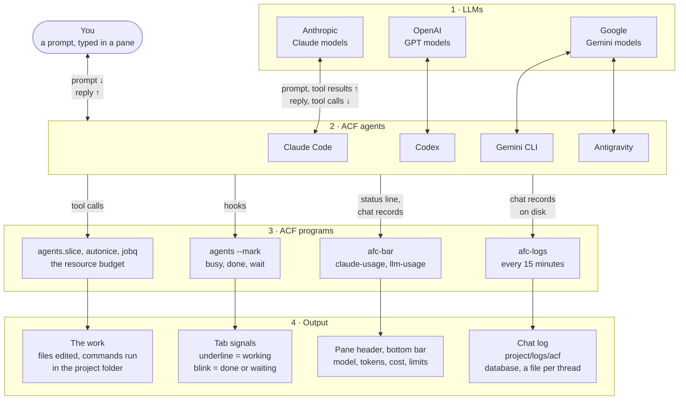

# Agentic CLI Fleet (ACF)

One terminal window that runs many coding agents at once, each in its own tab or split, on one Linux machine. Claude Code, Codex, Gemini CLI and Antigravity sit side by side; the fleet keeps them inside a memory and CPU budget, shows what each one is doing, and keeps a log of every conversation.

This folder is **where the fleet lives**. Its programs and its tmux config run from here: the usual home-folder paths (`~/.local/bin/agents`, `~/.local/bin/afc-*`, `~/.tmux.conf`, …) are links to the files in this folder, so an edit here is live at once (programs on their next call, the tmux config after Ctrl+B then R).

Three things stay as real files in the home folder, with a copy kept here: the resource guard (`autonice`, `jobq`, `keepawake-agents`), the systemd units, and the machine's own lists (accounts, projects, prices). They must keep working when this drive is not mounted, and the lists hold real account names. `bash _tools/collect.sh` refreshes those copies.

Moved here: 2026-11-16, on the Kubuntu 24.04 workstation.

**If this drive is not mounted or this folder is moved**, the links break and the fleet will not start. The last home-folder copies are in `~/.local/share/acf-home-backup-20261116/` with restore steps in its `README.txt`; after a move, `bash _tools/install.sh --apply` from the new place re-points the links.

## What it does

| Capability | What you get |
|---|---|
| **Many agents, one window** | One tab per project and any number of splits inside it. Each split runs Claude Code, Codex, Gemini CLI, Antigravity or a plain terminal, started fresh, in plan mode (read-only for Codex) or with no permission prompts. |
| **Picks up where you stopped** | After a restart `agents` reopens every tab and every split as it was: each agent on its own account and chat, the same sizes, minimised splits still minimised. A chat that is already open in another window gets a note instead of a second agent. |
| **Several accounts per tool** | Alt+G moves the agent in a pane to another account (Claude keeps the same chat) or to another tool. A new split starts on the account of the pane it came from. The Alt+G list shows what each Claude account has used of its plan limits and which has the most room, and a warning comes when a pane's account passes 90%. An agent moved to another tool can be handed the chat so far. A label can stand in for an account name on a shared screen. |
| **Shows what every agent is doing** | A tab's name is underlined while an agent in it works, and the tab blinks when one has finished or is waiting for an answer. When you are not looking at that tab, a desktop notification says so, and a click on it brings the tab up. Alt+L lists every agent in the fleet with what it is doing. Each pane's header shows tool, account, model, effort, tokens, share of the model's window, cost and plan limits. |
| **A window manager for splits** | Move, merge, minimise, maximise and close with a key or a click on the pane header. A thin scrollbar through the chat, copy longer than one screen, paste of text or an image. |
| **A folder of its own for a split** | A split can start in its own git worktree, on its own branch. Two agents in one project then no longer write over each other's files; one agent's work comes back with an ordinary `git merge`. |
| **A resource budget** | Every agent and everything it starts runs in one capped group: 3 CPU cores, slowed at 12 GB of memory, stopped at 14 GB. Builds, tests and agents get lower priority. At most 2 heavy jobs and 3 dev servers run at once; the rest wait their turn. The machine stays awake while agents work. |
| **A permanent chat log** | Every 15 minutes each tool's chat records are copied into the project they belong to: a searchable database and one readable file per thread, with secrets replaced by `[redacted]`. No model is asked, so it costs no tokens. |
| **Plan limits and cost at a glance** | Session and weekly limits per account for Claude, Codex and Antigravity, and what each conversation would cost at list prices. |
| **Rebuilds from this folder** | `install.sh` sets a machine up; `build-tmux.sh` builds the patched tmux with no download and no sudo. `agents --doctor` checks that everything is in place; `test-fleet.sh` tries the launcher on a throw-away fleet. |

## What you see

```
── [C / acct] [C5.5-Opu X] [T:265k 26% $22.24] [S0% W4%] ───────────── [↔ – □ ✕]     pane header
   ... the agent ...                                                          ▎          scrollbar
 ACF | 1 ProjectA | 2 ProjectB            [C:27%|R:47%|F:5 1.5G/12G]  ▣ 1  ◀  ▶        bottom bar
```

**Pane header**, one per split:

| Field | Meaning |
|---|---|
| `[C / acct]` | which tool (C Claude, X Codex, G Gemini, A Antigravity) and which account |
| `[C5.5-Opu X]` | model and effort: maker letter, version, 3 letters of the name, effort (L M H X) |
| `[T:265k 26% $22.24]` | tokens the chat holds, share of the model's window, cost (`~$` = estimated from list prices) |
| `[S0% W4%]` | plan limits used: 5-hour session, week (plus a per-model cap when that model is in use) |
| `[↔ – □ ✕]` | move, minimise, maximise, close: for that split |

**Bottom bar**: tabs, then machine CPU and RAM and the fleet's agent count and memory against its cap, `▣ N` when N splits are minimised, and previous / next tab.

## Keys

| Key | Does |
|---|---|
| Alt+1 … Alt+0 | jump to tab 1 … 10 |
| Alt+\ / Alt+- | split right / below, with a menu of what to start there |
| Alt+G | change the agent or account in this pane |
| Alt+M | pick the model or effort (Claude, Gemini) without the agent's own tall picker |
| Alt+L | list every agent in the fleet with what it is doing; pick one to go to it |
| Alt+J | move this split: left, right, up, down, merge under a neighbour, own column |
| Alt+H / Alt+U | minimise this split / bring a minimised one back |
| Alt+Z | maximise this split to the whole tab, and back |
| Alt+Q | close this split (asks first, in a Yes / No pop-up in the centre) |
| Alt+S / Alt+X | show another tab beside this one / send this pane to its own tab |
| Alt+N / Alt+C | add a project folder as a new tab / plain terminal tab |
| Ctrl+V | paste text or an image |
| Ctrl+click, scroll, Ctrl+click | copy a stretch longer than one screen |
| Ctrl+B then R | reload the config |

Everything with a button also lights up under the pointer and can be clicked, menus included.

## Commands

| Command | Does |
|---|---|
| `agents` | open the fleet, or attach to it if it is running; a start reopens the saved tabs and splits |
| `agents --fresh` | start with one pane per project instead of the saved splits |
| `agents --layout` | show the saved tabs and splits: what the next start reopens |
| `agents --overview` | every agent in one list: tab, working / waiting / done, tokens, cost, limits |
| `agents --worktrees` | the work folders made for splits; `--prune` removes the finished ones |
| `agents --doctor` | check that links, hooks, services and the watcher are in place; changes nothing |
| `agents --add [folder] [name]` | add a project (default: this folder); opens its tab if the fleet is up |
| `agents --status` | list the tabs and the fleet's memory |
| `agents --dry-run` | show what would open, start nothing |
| `agents --accounts` | list every tool's accounts and who is signed in to each |
| `agents --usage` | plan limits per Claude account |
| `agents --as <account>` | run Claude on that account in any terminal (`gemini:<account>`, `codex:<account>`, `agy:<account>` for the others) |
| `agents --kill` | stop every agent (asks first) |
| `afc-logs search WORDS` | search this project's chat log (`--all` for every project) |
| `afc-logs threads`, `afc-logs show THREAD` | list the threads, print one |
| `jobq <command>` | run a heavy command when a slot is free, instead of being paused |
| `jobq --status`, `autonice --status` | who holds the slots, what is throttled |
| `bash _tools/test-fleet.sh` | try the launcher on a throw-away fleet: about 80 checks in three minutes, nothing real is touched |

## How it works

A turn runs top to bottom: a model answers, the agent in the pane acts on the answer, and the fleet's programs turn what the agent did into what you see and what is kept.



### 1 · The LLMs

The models run on their makers' servers, not on this machine. Each agent talks straight to its own maker, over the account its pane is on.

| Agent | Models | An account is |
|---|---|---|
| Claude Code | Anthropic's Claude | a Claude config folder (`CLAUDE_CONFIG_DIR`) |
| Codex | OpenAI's GPT | a Codex home folder (`CODEX_HOME`) |
| Gemini CLI | Google's Gemini | a Gemini home folder (`GEMINI_CLI_HOME`), on an API key or an enterprise sign-in |
| Antigravity | Gemini, and the Claude and GPT models Google offers through it | a stand-in home folder with its own Google sign-in |

The fleet runs no model and sits in none of these requests. It decides where an agent runs: which folder, which tool, which account, which mode. Its own programs ask no model anything either: the header figures and the chat log are read from files the tools already keep, and the plan limits from each maker's usage figures.

**Changing the account or tool in a pane** (Alt+G)

1. The menu lists every account of every tool, with who is signed in. Each Claude account shows what it has used of its plan limits, and the one with the most room is marked.
2. Another Claude account: the pane restarts on that account and resumes the same chat. All Claude accounts share one chat store through links; only the sign-in differs. The move is remembered, so a restart reopens that chat on that account.
3. Another tool: chats do not carry over between tools, so a second menu asks what the new agent starts from. "This chat" brings the chat log up to date and starts the agent with one instruction: read that chat's log (secrets already taken out) and say where the work stands. That costs the new agent the tokens of what it reads. The other choice is a new chat.
4. When an agent ends a turn and its account has used 90% or more of a plan limit, a notification says so and names the account with the most room. It is said once per account in half an hour.

### 2 · The ACF agents

An agent is one of the four tools running in a split of the fleet's tmux window: one tab per project, any number of splits per tab.

**Starting the fleet** (`agents`, or the Agents entry in the desktop menu)

1. `agents` reads the project list, `~/.config/agents/projects`: one `<tab name> <folder>` per line.
2. It starts the tmux server inside `agents.slice`, so everything started from a tab falls under the budget.
3. Each tab in the saved layout that is still on the list comes back with all its splits (below). Any other project gets a tab with one pane: a folder with an earlier chat continues it, on the account that chat belongs to; otherwise a new chat starts.
4. The window attaches. If the fleet is already running, `agents` attaches to it; a second window gets its own view of the same agents.

**The saved layout** (`~/.local/state/afc/layout`, looked at every 20 seconds)

1. While the fleet runs, a watcher asks tmux every 20 seconds whether a tab or a split changed, and `agents --mark` leaves it a note when an agent ends a turn. Only then does it read the whole fleet and rewrite the file: per tab its name, project and tmux layout; per split the tool, the account, the chat and the folder.
2. The chat is exact for Claude (its own record of the run) and Codex (the session file it holds open). Antigravity: the conversation it holds open, else the folder's newest one, for the first Antigravity split in that folder. Gemini can only be told "the latest": the first Gemini split in a folder gets that. Any further Antigravity or Gemini split in the same folder comes back with a new chat.
3. Nothing is written unless the whole fleet could be read and did not change during the read. A layout with fewer splits than the one on file is written only after it has held still for three looks, so a closed split leaves the file about a minute later and a fleet that is going down never replaces the last good layout with half of one. `agents --kill` saves once more before it stops.
4. At the next start each split is reopened in its place, at its size, with the focus where it was, and minimised splits go back to minimised. A split started in plan mode comes back in plan mode. The agents start 2 seconds apart, not all at once; Enter in a waiting pane starts that one now. A project taken off the list stays closed. A project tab in which every agent had ended still opens with one, on the folder's last chat. `agents --fresh` starts without the saved layout.

**One turn**

1. You type a prompt in a pane. The agent sends it to its model, along with what it has read of the project.
2. The model answers with text and with tool calls: read this file, edit that one, run this command.
3. The agent carries the tool calls out in the project folder and sends the results back to the model. Steps 2 and 3 repeat until the model asks for nothing more. Then the turn ends and the reply stands in the pane.
4. An agent started in plan mode only proposes changes. One with permission prompts on stops and asks before a tool call that needs your yes.

**A work folder of its own** (split menu: "New agent in its own work folder")

1. The launcher makes a git worktree of the project beside it, `<parent>/.acf-worktrees/<project>-<n>`, on a new branch `acf/<project>-<n>`, from the commit the split it came from is on. The agent starts there.
2. The pane header shows the branch after its figures, as `⎇ acf/<project>-<n>`. The chat log still files that split's chats under the project.
3. To bring the work back: `git merge acf/<project>-<n>` in the project folder. `agents --worktrees` lists the folders with their state; `agents --worktrees --prune` removes those that are finished: nothing uncommitted, every commit already in the project, no split in it. It asks first, and git does the removing without force.
4. A folder that is not a git project gets no work folder: the pane says so and starts no agent.

### 3 · The ACF programs

Four pieces stand between the agents and the output, one per arrow that leaves the agents in the diagram.

**The resource budget** (`agents.slice`, and `autonice` every 5 seconds)

1. tmux runs inside `agents.slice`, so every agent and every command a tool call starts shares one budget: 3 CPU cores, slowed at 12 GB of memory, stopped at 14 GB.
2. Processes that match `~/.config/autonice/rules` get a lower CPU and disk priority and are moved into the capped group. Priority is only ever lowered.
3. A background job that matches a `gate` rule takes a slot. With no slot free it is paused, and resumed when one frees. `jobq <command>` waits for a slot instead.
4. If `autonice` stops, it first resumes everything it paused.

**Tab signals** (`agents --mark`)

1. Hooks in Claude's settings call `agents --mark`: `busy` when a prompt is sent or a tool runs, `done` when the turn ends, `wait` when it asks for permission, `end` when it closes.
2. Codex has no such hooks, so the fleet's watcher reads the same from Codex's session file, which names the start and the end of every turn. Antigravity keeps no such marks, and Gemini only reports when its settings carry the hooks: for those the watcher takes "its chat file is being written" as working and 20 quiet seconds as done. That is an estimate.
3. `--mark` sets a flag on the pane and tmux draws it: the tab's name is underlined while any agent in it is busy, and the tab blinks when one finishes or waits while you are looking elsewhere. Looking at the tab clears the blink.
4. A turn that ends with a background command still running stays underlined until that command ends.
5. When an agent asks you something, or ends a turn that took 30 seconds or more, and you are not looking at its tab in a focused window, a desktop notification says which tab. "Open the tab" in it brings the Agents window and that split to the front. Estimated signals send none. `~/.config/agents/settings` turns these off or changes the 30 seconds.

**The pane header** (`afc-bar`, redrawn about once a second)

1. Claude hands its status-line data to `afc-statusline`, which saves model, effort, limits, tokens and cost for that pane.
2. `afc-bar` works out which tool and account the pane runs from the pane's own processes, reads that saved line, and adds the plan limits from `claude-usage` or `llm-usage`. Both answer from a cache and refresh it in the background, so the bar never waits.
3. Codex, Gemini and Antigravity have no status line: `afc-agent-info` reads the same facts from the chat records they keep on disk.

**The chat log** (`afc-logs`, every 15 minutes)

1. The run is skipped when CPU or RAM is at 85% or more.
2. It finds the chat files that changed, for all four tools, and reads what is new.
3. Each thread goes to the project it ran in: the fleet project, else the nearest folder above with a `.git`, `CLAUDE.md`, `AGENTS.md` or `_ai`, else the folder itself. Chats run in the home folder or a temp folder go to `~/logs/acf/`.
4. Secrets are replaced by `[redacted]`, then the entries go into `logs/acf/acf.db` (full-text search) and one `.md` file per thread. In a git project, `logs/acf/` is added to `.gitignore`.

### 4 · The output

What a turn leaves behind, and where.

| Output | Where it lands | Made by |
|---|---|---|
| The work | the project folder: the files the agent edited and whatever its commands produced | the agent's tool calls, inside the budget |
| The reply | the pane; tmux keeps the chat history for the scrollbar | the agent |
| Tab signals | the tab's name in the bottom bar: underlined while an agent works, blinking when one is done or waiting | Claude's hooks or the watcher, then `agents --mark` |
| Notifications | the desktop, when an agent is done or waiting and you are not looking at its tab | `agents --mark`, then `agents --notify` |
| Figures | the pane header and the bottom bar: tool, account, model, effort, tokens, cost, plan limits, fleet memory | `afc-statusline` or `afc-agent-info`, then `afc-bar` |
| The chat log | `<project>/logs/acf/`: `acf.db` and one `.md` file per thread, secrets redacted | `afc-logs` |

## What is in this folder

"Home path" is where the machine looks for it. **link** = the home path points at this folder's file (this is the live one); **copy** = the live one is a real file at home and this is its copy.

| Path | Home path | What it is |
|---|---|---|
| `bin/agents` | link: `~/.local/bin/agents` (also as `afc`) | the launcher: opens the fleet, tabs, splits, account and split menus; saves the layout and reopens it |
| `bin/afc-bar` | link: `~/.local/bin/` (so are all `bin/afc-*` and the two usage tools) | draws the pane header and the bottom bar's figures |
| `bin/afc-statusline` | | Claude's status-line hook: records model, effort, limits, tokens, cost per pane |
| `bin/afc-agent-info` | | the same facts for Codex, Gemini and Antigravity, read from their own chat records |
| `bin/claude-usage`, `bin/llm-usage` | | plan limits per account |
| `bin/afc-logs` | | the chat log: every thread copied into `<project>/logs/acf/`, searchable, no tokens |
| `bin/afc-min`, `bin/afc-move` | | minimise / restore, and move / merge splits |
| `bin/afc-reflow`, `bin/afc-gap` | | make Claude redraw after a resize, and close the gap its pop-ups leave |
| `bin/afc-longcopy`, `bin/afc-model-menu` | | long copy, and the Alt+M menu |
| `bin/autonice`, `bin/jobq`, `bin/keepawake-agents` | copy: `~/.local/bin/` | the resource guard: renices, caps and queues heavy jobs; keeps the machine awake while agents work |
| `lib/afc/pb.py` | link: `~/.local/lib/afc/` | reads Antigravity's binary records |
| `tmux/tmux.conf` | link: `~/.tmux.conf` | all keys, bars, hooks and the scrollbar |
| `tmux/afc-tmux-3.8.patch` | copy: `~/.local/opt/tmux-3.8/` | the changes to tmux 3.8 the fleet needs (below) |
| `tmux/src/`, `tmux/deps/`, `tmux/SHA256SUMS` | | the tmux 3.8 source, the build packages, and their checksums: what `build-tmux.sh` builds from |
| `config/agents/` | copy: `~/.config/agents/` | account lists per tool, project list, price table, labels, `settings` (notifications, limit warning, start gap) |
| `config/systemd/user/` | copy: `~/.config/systemd/user/` | `agents.slice` (the budget), `autonice`, the chat-log timer |
| `config/autonice/rules` | copy: `~/.config/autonice/` | which programs get throttled or queued |
| `config/alacritty/` | copy: `~/.config/alacritty/` | the terminal the fleet window runs in |
| `config/claude/`, `config/gemini/` | | only the fleet's keys from those tools' settings, to merge by hand |
| `share/` | link: `~/.local/share/` | the desktop launcher, the window-raise script, the no-browser stand-ins |
| `_tools/` | | `collect.sh`, `install.sh`, `build-tmux.sh`, `test-fleet.sh` |
| `logs/acf/` | | this folder's own chat log, written by `afc-logs` when an agent works here (raw transcripts: they name the real account) |

Not here, on purpose: sign-ins, other projects' chats and logs, and the built tmux program (it is rebuilt from `tmux/` and stays on the home disk, so tmux itself starts even without this drive).

## The tmux build

The fleet runs tmux 3.8 with one small patch file (`tmux/afc-tmux-3.8.patch`: five files of the fleet's own changes and two files of a fix taken from upstream tmux), installed in `~/.local/opt/tmux-3.8` with `~/.local/bin/tmux` pointing at it. Stock tmux will run the config but loses these:

| Patch | Gives |
|---|---|
| `screen-redraw.c`, `window-copy.c` | a thin scrollbar slider (`@scrollbar-slider`) that stops short of the pane's bottom (`@scrollbar-bottom-margin`) |
| `format.c` | the column and row of a click on a pane border, so the header buttons can be told apart |
| `key-string.c`, `server-client.c` | mouse hover: `@mouse-hover on`, and bindable `MouseMoveStatus` / `MouseMoveBorder` / `MouseMovePane` |
| `screen-write.c`, `window-visible.c` | menus that stay whole. In stock 3.8 an agent redrawing its lines paints over an open menu until the next status redraw. This is upstream tmux's own fix (commit `a21247a`, GitHub issue 5593), made after 3.8 and carried here unchanged; leave it out on the next tmux release |

To build it, everything needed is in this folder: the official source (`tmux/src/tmux-3.8.tar.gz`), the patch, and the four build packages (`tmux/deps/`, Ubuntu 24.04 amd64; unpacked to a temporary folder, never installed). No download and no sudo:

```bash
bash _tools/build-tmux.sh --dry-run
```

```bash
bash _tools/build-tmux.sh
```

It takes about a minute, installs into `~/.local/opt/tmux-3.8`, and keeps the previous program beside the new one. Add `--prefix <folder>` to try a build without touching the installed one. A running fleet only picks up a new build after a restart.

To change tmux itself: unpack the source, apply the patch, edit, then write the new differences back to `tmux/afc-tmux-3.8.patch` (same `orig/tmux-3.8/…` and `src/tmux-3.8/…` path style, applied with `patch -p2`) and run the build script.

## Things that will bite

- **Claude runs in classic mode** (`"tui": "default"`): that is what lets tmux keep the chat history for the scrollbar. The price is that Claude does not re-wrap on its own; `afc-reflow` and `afc-gap` press Ctrl+L for it.
- **A chat belongs to an account.** A restart reopens each chat on the account that owns it, and a new split takes the account of the pane it came from. Resuming a chat on another organisation's account makes Claude drop its earlier thinking.
- **A fleet restart stops every agent.** Tabs, splits and chats come back (the saved layout, above). The step an agent was in the middle of, jobs in terminal splits and a maximised split do not, and a terminal split comes back as an empty shell in its folder. A split that ran with no permission prompts comes back in normal mode on purpose: nothing should run unasked after a restart you may not have watched.
- **A work folder starts from the last commit.** Changes not yet committed in the project are not in it, and neither is anything git ignores (`node_modules`, `.env`), so the agent there may have to install first.
- **Start the fleet from the desktop**, not from inside an agent's shell: that shell's environment would leak into every agent.
- **Claude deletes its own chat files after 30 days.** `afc-logs` is the permanent copy.

## Stand-in names

One account name on the machine is not allowed in this workspace's documents. In the copied lists under `config/` it reads `acct1` (account lists, folder paths, a commented line); a few comments in `bin/` say `acct1` too, which changes nothing in how they run. The real name and the pairing live only on the machine, in `~/.config/agents/copy-names`. `collect.sh` swaps the name out of `config/` on the way in and `install.sh` swaps it back on the way out, so the live fleet is never renamed. On a machine without that map, `install.sh` installs the stand-in as the account's name. The chat log in `logs/acf/` is a raw record and is not swapped.

## Changing the fleet

- A program in `bin/`, `lib/` or `share/`, or `tmux/tmux.conf`: edit it here. It is the live file.
- A machine list, a systemd unit or the resource guard: edit the real file in the home folder, then bring the copy here up to date:

```bash
bash _tools/collect.sh --dry-run
```

```bash
bash _tools/collect.sh
```

To set a machine up to run the fleet from this folder (dry run unless `--apply` is given; links by default, `--apply --copy` for real copies):

```bash
bash _tools/install.sh
```
